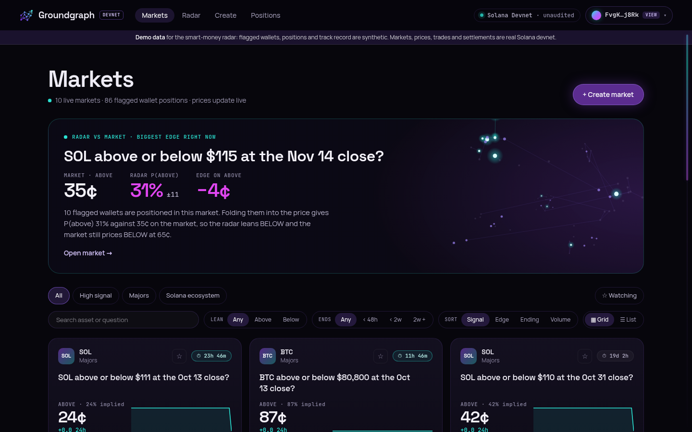
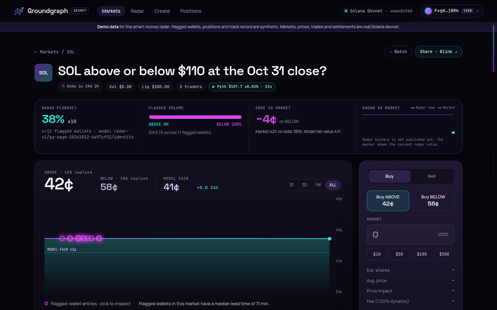
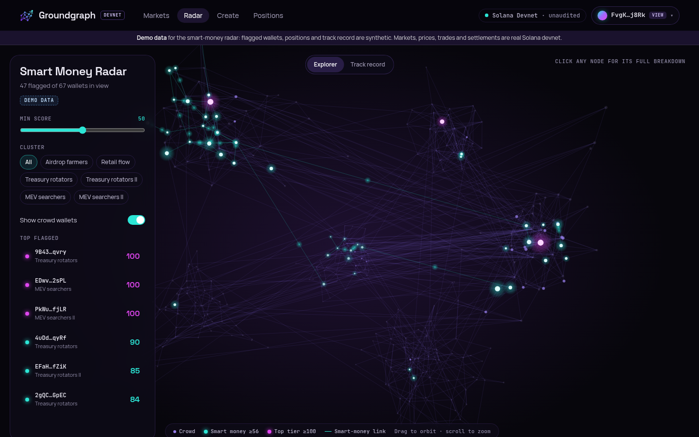
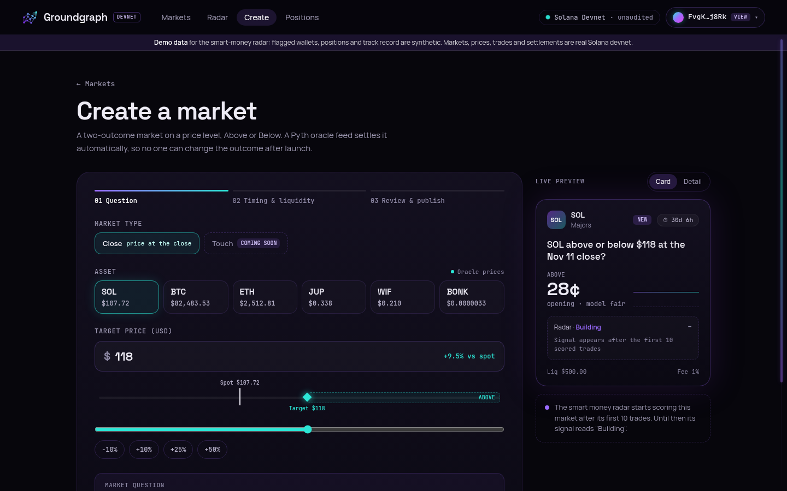
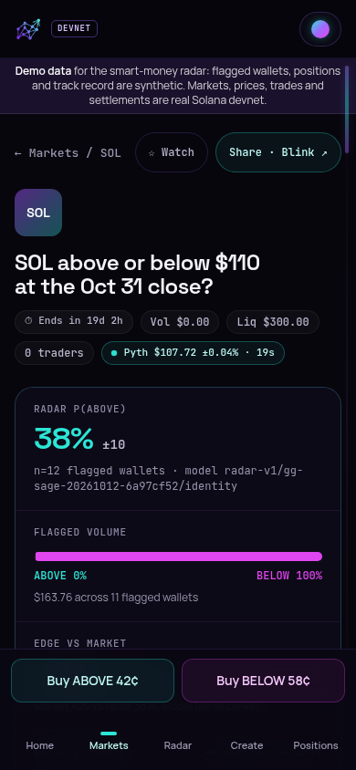

# Groundgraph

**Prediction market and alpha platform on Solana.** Trade ABOVE / BELOW price markets on an original Anchor AMM settled by Pyth oracles,
while a GraphSAGE wallet-graph model flags smart money and turns it into an explainable, calibrated signal next to every market.

Built solo for the Colosseum **Crypto World's Fair** hackathon. Everything here runs on Solana **devnet** with free test USDC.

- Non-custodial: the server only builds unsigned transactions, your wallet signs.
- Wallet-only sign-in (Sign-In With Solana). No email, no password. Pasting an address gives a read-only view session.
- Self-hostable on one PC with `docker compose up`, no paid provider and no card.

## Live on devnet

| Item | Value |
|---|---|
| Program ID | [`5W8BS9j9ZFH7Uscjq2Sh7tU5SVmvf7Ay3fJMDjTnRPCC`](https://explorer.solana.com/address/5W8BS9j9ZFH7Uscjq2Sh7tU5SVmvf7Ay3fJMDjTnRPCC?cluster=devnet) |
| Test USDC mint (6 decimals) | `6dW4uZXnwUXyzU1ah3NJqAEu7dEM7A3nSkPP9jH2DPy1` |
| Deploy transaction | `4avUg3tsDsfJTw2negkHggi2BA9ejd2YU5Yp7KHJAtv3vVJQT98yty3NYUFgckm6j8Lhj3dCcasYrXW5hiNukVfe` |
| Binary | 266,216 bytes, sha256 `afd8f685...`, verified against the on-chain bytes after deploy |
| Oracle feeds allowed | SOL, BTC, ETH, JUP, WIF, BONK (USD, Pyth) |

Seeded markets (all Close markets, created by the bootstrap script; addresses are deterministic from the maker key and nonce):

| # | Question | Settles (UTC) | Market account |
|---|---|---|---|
| 1 | SOL above or below $106 | Oct 12, **settled ABOVE** by the keeper (SOL closed at $107.66) | `AcBWWSzRnuAzc8WineEXbE6AtSYLBcikM2XdbkebRByV` |
| 2 | ETH above or below $2,540 (dynamic fee) | Oct 12 | `2sK4wT7b2HR1CzStS5KSzVzic8UFpScnCY5d5ZydGcH5` |
| 3 | BTC above or below $80,800 | Oct 13 | `GFhsvxdAaKznDAuTpjW5R2ctPTn2TqLmDy4dRyBvSAi8` |
| 4 | SOL above or below $111 (dynamic fee) | Oct 13 | `DcH1gZ95dnpJw5ns7NZ4tACuQUsXSsLAQYd5UjAdJmvG` |
| 5 | JUP above or below $0.324 | Oct 14 | `Gn8NyTHcyKgYRZjiQZ1JihYA4o8AtjEKsc6yjgmz2idQ` |
| 6 | WIF above or below $0.227 | Oct 17 | `DuhWxS3DzmjF1JSiuuEbmK9FWeJWSH4F6VSnHia6TdCi` |
| 7 | SOL above or below $110 (dynamic fee) | Oct 31 | `2DNWHY1bWp7QH6pFowD2SqjrkTmAJwyv1VxxSDk4Bfzn` |
| 8 | ETH above or below $2,600 (dynamic fee) | Oct 31 | `CT8P9JBnnqxRACr2Mv5BjzstoiL6vrcMaEE528gFFi3J` |
| 9 | SOL above or below $115 (dynamic fee) | Nov 14 | `8HfWHGami1mn1kiej3iPxnR3GEA9rpDDj1ynXQncLVB5` |
| 10 | BTC above or below $85,000 | Nov 14 | `6T2GCwrEGA31WHiAgkDGymH9Jau7yyd4k3rFVHAR6ZZS` |
| 11 | SOL above or below $108 | Oct 12, 18:58 UTC (35 minute demo market) | `GLrRTU3NhGxDqTWKoRCjSnYFKccUmNQvssYcLR2MRLSt` |
| 12 | ETH above or below $2,510 (dynamic fee) | Oct 12, 19:03 UTC (40 minute demo market) | `3hwJDKTAcboK6YFAatPbAFMiRetkFMp5Sm7Qdab3jbSr` |
| 13 | BTC above or below $82,500 | Oct 12, 19:08 UTC (45 minute demo market) | `8gUaTbEXM9AxSuJscuR94LbK749k542PJc8qv6hh6gCM` |

Market 1 is a live proof of the full path: at its settlement time the keeper fetched the signed Pyth update, posted it through the Pyth receiver and called `settle_close` ([transaction `61QDvJ55...`](https://explorer.solana.com/tx/61QDvJ55ryyTZufPj6EYhW9WX9Da8pecVtg5Tou3T9R8YtBshCYhwLitjzKJfmVb1sxNH2mPGhjK3x9BW8vNt2Q9?cluster=devnet)). The other short-dated markets exercise the same path, or the void path with a $0.50 refund when no valid oracle update arrives (see Honest scope); the Oct 31 and Nov 14 markets stay open for review.
Anyone can create more from the Create screen (devnet minimum duration: 30 minutes).

## Screenshots

Captured from the running stack against devnet (view-only session; the ribbon marks the radar data as demo data).

| Markets | Market detail |
|---|---|
|  |  |
| **Smart money radar** | **Create a market** |
|  |  |

Mobile (390 px): 

## How it works

**Markets.** Every market asks one question: will the asset's price be ABOVE or BELOW a target at a settlement time. One ABOVE share plus one
BELOW share (a complete set) is always worth exactly 1 USDC. At settlement the winning outcome redeems at $1 per share and the other at $0.
You can also merge a complete set back into 1 USDC at any time while the market is open.

**AMM.** A fixed-product market maker over complete sets with virtual reserves (no pool token accounts). Price of ABOVE is `rb / (ra + rb)`,
trades are exact integer math with rounding in favor of the pool, and slippage limits are enforced on every trade. Opening prices come from a
digital-option fair value (Pyth spot plus volatility), so a new market does not hand arbitrageurs a free edge.
The fee has three parts: a base tier (0.5%, 1% or 2%), a near-expiry component (up to +0.8% over the last 72 hours) and a "Recent flow"
component (up to +0.5%, from an exponential moving average of price impact), capped at 3%.

**Settlement.** `settle_close` can be called by anyone with a verified Pyth `PriceUpdateV2` account. The program checks the feed id, a 60 second
publish-time window starting at `settle_ts`, a confidence limit (0.5%), and full verification. If no valid update arrives within an hour, anyone can void the
market and every share redeems at $0.50. Buying stops 5 minutes before settlement on devnet (1 hour on the mainnet default).

**Smart money radar.** A scorer reads wallet activity, builds a transaction graph, and scores each wallet with five explainable features plus a
GraphSAGE embedding head. Louvain clusters group wallets; clusters that look like one actor are capped at half weight (sybil rule). For each market,
flagged wallets' positions are folded into the market price:
`logit(p_radar) = logit(p_market) + 1.4 * n/(n+6) * signal`, with a confidence interval and an "edge vs market" in cents. If there is not enough
evidence the UI says "Building" instead of showing a number. The same formula runs in Python (scorer) and TypeScript (SDK); 74 golden cases agree exactly on state, sample count, interval and edge, and the probability matches to within 2e-16.

**Non-custodial.** The API builds unsigned v0 transactions (simulated first); the wallet signs and sends. The keeper only pays fees for settlement and never holds user funds.

## Architecture

```
  Solana devnet                              Pyth (push feeds, Hermes)
   |  program logs / accounts                   |  prices
   v                                            v
 indexer ---> Postgres <--- keeper ---(settle / void txs)---> Solana
   |             ^   ^         |
   | pub/sub     |   |         | oracle, fair value, volatility
   v             |   |         v
  Redis <--------+---+--------- Redis
   |             |
   v             | scorer (Python, GraphSAGE) writes scores, clusters, radar, track record
  API (REST + WebSocket + Blinks) ---> web app (Next.js) ---> wallet (signs)
```

| Part | Path | Stack |
|---|---|---|
| On-chain program | `programs/groundgraph` | Rust, Anchor 1.2.1, Pyth receiver SDK, raw SPL Token CPIs |
| TypeScript SDK | `packages/sdk` | math identical to Rust (2000+ generated vectors), decoders, instruction builders |
| API | `services/api` | Fastify 5, Zod 4, SIWS sessions, WebSocket, Solana Actions (Blinks), OG images |
| Indexer | `services/indexer` | idempotent event ingest, positions, resumable backfill |
| Keeper | `services/keeper` | oracle poller, fair values, volatility, settle and void |
| Scorer | `services/scorer` | Python, hand-written GraphSAGE, Louvain, calibration, track record |
| Web | `apps/web`, `packages/ui` | Next.js 16, React 19, Tailwind 4, TanStack Query, wallet-adapter |
| Data | `packages/db` | Postgres 16 migrations and typed queries, Redis for pub/sub and caches |
| Infra | `docker-compose.yml`, `infra/` | one compose file, Caddy reverse proxy |

More detail: [docs/ARCHITECTURE.md](docs/ARCHITECTURE.md), [docs/AMM.md](docs/AMM.md), [docs/THREAT_MODEL.md](docs/THREAT_MODEL.md),
[services/README.md](services/README.md), [services/scorer/MODEL_CARD.md](services/scorer/MODEL_CARD.md).

## Run it

### Self-host with Docker (recommended)

```bash
# 1. put the devnet keys in .keys/ (keeper.json and faucet.json are mounted into the containers)
# 2. create .env with the program ID, mint and random secrets
node scripts/make-env.mjs
# 3. start everything
docker compose up -d --build
# 4. open the app
#    http://localhost:8080
```

The full guide, including public access through a free tunnel and the optional keys (Pyth, Helius), is in [docs/SELF_HOSTING.md](docs/SELF_HOSTING.md).

### Develop without Docker

```bash
pnpm install
scripts/dev-db.sh groundgraph                       # Postgres 16 from the migrations
node scripts/make-env.mjs && set -a && . ./.env && set +a
pnpm --filter @groundgraph/api start                # :8787
pnpm --filter @groundgraph/indexer start            # :9102
pnpm --filter @groundgraph/keeper start             # :9101
(cd services/scorer && python -m scorer run-once --source synthetic --train)
pnpm --filter @groundgraph/web build && pnpm --filter @groundgraph/web start   # :3000
```

Frontend only, against a mock API: `pnpm --filter @groundgraph/web dev:mock`.

### Demo

[docs/DEMO_SCRIPT.md](docs/DEMO_SCRIPT.md) is a 3 minute walkthrough: connect a devnet wallet, claim test USDC, trade, read the radar, create a market, watch it settle, redeem.

## Tests and measured results

| Suite | Command | Result |
|---|---|---|
| Program unit and property tests | `cargo test -p groundgraph --lib` | 26 pass |
| Program integration (LiteSVM, real binary) | `cargo +1.99.0 test -p groundgraph-tests` | 64 pass: lifecycle, void, pause, fee tiers, a negative test per constraint, randomized run that drains the vault exactly |
| SDK | `pnpm --filter @groundgraph/sdk test` | 131 pass; bit-exact parity with Rust over 2000+ vectors |
| API | `pnpm --filter @groundgraph/api test` | 142 pass, including a cross-service end to end |
| Indexer | `pnpm --filter @groundgraph/indexer test` | 62 pass |
| Keeper | `pnpm --filter @groundgraph/keeper test` | 76 pass |
| Shared packages | `pnpm --filter @groundgraph/svc-core test`, `@groundgraph/db` | 52 and 7 pass |
| Web unit | `pnpm --filter @groundgraph/web test` | 157 pass |
| Web end to end (Playwright, fake wallet, mock API) | `pnpm --filter @groundgraph/web test:e2e` | 49 pass at 1440, 834 and 390 px |
| Scorer | `python -m pytest tests -q` in `services/scorer` | 235 pass |

On devnet: the deploy was verified byte for byte against the local binary, and `pnpm --filter @groundgraph/scripts smoke:devnet` buys, sells and merges
on a seeded market and asserts that the SDK quote equals the on-chain fill and that the vault stays solvent. Compute units per instruction (LiteSVM):
create_market 120k to 137k, buy about 18k, sell about 19k, merge about 16k, settle about 13k, redeem about 14k.

Scorer quality on its **synthetic** world (326 wallets, 365 days, seed 20261012; these numbers say nothing about mainnet):
held-out ROC AUC 0.849 (95% CI 0.815 to 0.880) for the deployed score against 0.753 for heuristics alone and 0.878 for GraphSAGE alone;
Brier of the radar 0.0488 against 0.0501 for the market (paired bootstrap interval of the difference [-0.0025, -0.0004]);
ECE 0.041 for the radar against 0.037 for the market. The isotonic calibrator was not adopted because its cross-fitted Brier was worse.
Full detail in the [model card](services/scorer/MODEL_CARD.md).

## Honest scope

- **Devnet only, unaudited.** Test USDC has no value. The upgrade authority and admin are single devnet keys. See the [threat model](docs/THREAT_MODEL.md) for residual risks.
- **Demo data is labelled.** Without a Helius key the scorer runs on a synthetic world, so the radar, flagged wallets and track record are demo data. The app shows a "Demo data" ribbon whenever that is the case. Markets, prices, trades and settlements are real devnet data.
- **Pyth keys and settlement reliability.** Pyth Hermes and Benchmarks now require an API key (Pyth lists a free trial at pythdata.app/signup). With `PYTH_API_KEY` the keeper fetches the signed update for the exact settlement time and settles the feeds the key is granted; the trial key used for the demo covered SOL, ETH and BTC only, and the keeper logs a warning for each refused feed and keeps reading its price from the on-chain push feed. Without a key it can only use the on-chain devnet push feeds, which is best effort: the program accepts a price published within 60 seconds after `settle_ts`, and those feeds update irregularly (on 12 Oct the SOL feed next updated 2 minutes 20 seconds after market 1's settlement time, so keyless settlement of that market missed its window). A market that cannot be settled is voided one hour after `settle_ts` and every share redeems at $0.50; funds are never stuck.
- **Region limits.** The code default geofence blocks the US and sanctioned countries for buying and creating; the generated devnet `.env` only blocks sanctioned countries (CU, IR, KP, SY) because test USDC has no value. Sells, merges and redeems are never blocked.
- **Not in this version:** Touch markets, adding liquidity after launch, per-user guards, the admin app, practice mode, credits and i18n. The program reserves the touch and guard fields and rejects them with `NotEnabledInThisVersion`.
- **Known gaps:** share balances follow program events only (wallet-to-wallet transfers of outcome tokens are not tracked); LP fee earnings are not computed per position; the Docker images were written and their install layout rehearsed, but no Docker daemon was available while building.

## Repository layout

```
programs/groundgraph/   Anchor program, IDL, deployment records
packages/sdk/           TypeScript SDK and API types
packages/db/            Postgres migrations and queries
packages/svc-core/      shared service code
packages/ui/            design tokens and components
services/               api, indexer, keeper, scorer
apps/web/               Next.js app
scripts/                deploy, bootstrap, smoke, create-market, faucet, make-env
infra/                  Dockerfiles and Caddyfile
docs/                   architecture, AMM, threat model, decisions, versions, self-hosting, demo script
tests/                  LiteSVM integration crate
```

Design decisions are recorded in [docs/DECISIONS.md](docs/DECISIONS.md) and library versions in [docs/VERSIONS.md](docs/VERSIONS.md).
